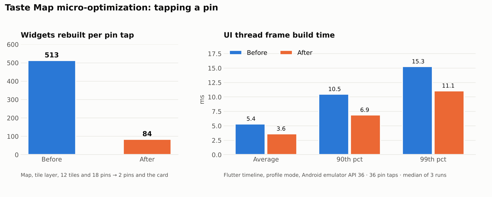

# Taste Map micro-optimization: profiling before and after

Sprint 4, item 3. Issue front-flutter #36. Code: `lib/screens/taste_map_screen.dart`.

## What was measured

Tapping the pins of the Taste Map. The integration test `integration_test/taste_map_perf_test.dart` opens the
Taste Map with 18 picks around the campus center (fake GPS and backend, so every run sees the same data), waits
for the map tiles and taps every pin twice: 36 taps. The Flutter timeline is recorded twice:

1. `taste_map_pin_taps`: the taps as they are, for frame times.
2. `taste_map_pin_taps_builds`: the same taps with `debugProfileBuildsEnabled`, which adds one timeline event per
   widget build. It slows every build down, so its frame times are only compared with each other; it is used to
   count which widgets rebuild on each tap (`count_rebuilds.py`). Before the optimization the timeline buffer fills
   up after about 22 taps because of the many build events, so the counts are divided by the taps that fit.

Tool: Flutter timeline recorded by `integration_test` (`binding.traceAction`) in **profile mode**, summarized by
`flutter_driver`'s `TimelineSummary`. Device: Android emulator, API 36 (x86_64). 3 runs before and 3 after.

```
flutter drive --profile --no-dds --driver=test_driver/perf_driver.dart --target=integration_test/taste_map_perf_test.dart
python docs/profiling/count_rebuilds.py build/taste_map_pin_taps_builds.timeline.json
```

## Results

| Metric | Before (median) | After (median) | Change | Before, runs 1/2/3 | After, runs 1/2/3 |
|---|---|---|---|---|---|
| Widgets rebuilt per tap | 513 | 84 | -84% | 512 / 533 / 513 | 84 / 84 / 85 |
| `FlutterMap` + `TileLayer` + `MarkerLayer` rebuilt per tap | 3 | 0 | -100% | 3 / 3 / 3 | 0 / 0 / 0 |
| Map tiles (`Tile`) rebuilt per tap | 12 | 0 | -100% | 12 / 13 / 12 | 0 / 0 / 0 |
| Pins (`_Pin`) rebuilt per tap | 18 | 2 | -89% | 18 / 19 / 18 | 2 / 2 / 2 |
| Average frame build time (ms) | 5.35 | 3.64 | -32% | 5.25 / 5.35 / 5.56 | 3.64 / 3.62 / 4.18 |
| 90th percentile frame build time (ms) | 10.49 | 6.89 | -34% | 10.49 / 9.99 / 10.88 | 6.43 / 6.89 / 8.14 |
| 99th percentile frame build time (ms) | 15.28 | 11.08 | -28% | 19.37 / 14.22 / 15.28 | 11.08 / 8.97 / 14.54 |
| Garbage collection time on the UI thread (ms) | 25.9 | 11.6 | -55% | 27.7 / 25.9 / 15.2 | 7.4 / 11.6 / 18.7 |
| Average frame build time with build profiling on (ms) | 20.82 | 4.75 | -77% | 19.82 / 20.91 / 20.82 | 4.60 / 4.75 / 4.92 |
| Frames over the 16 ms build budget, with build profiling on | 22 | 0 | -100% | 22 / 22 / 22 | 0 / 0 / 0 |



Raster times are not in the table: the change only touches the UI thread (what is built), not what is painted,
and on the emulator the raster thread runs on software rendering, so it varies between runs for reasons
unrelated to this change. They are in every `*.timeline_summary.json`.

## Files

- `before/run1..3`, `after/run1..3`: the `TimelineSummary` of both traces of every run.
- `before/rebuilds_per_tap.csv`, `after/rebuilds_per_tap.csv`: widget rebuilds per tap of every run.
- `timelines_run1.zip`: the full timelines of run 1 before and after. Open a `*.timeline.json` in Flutter DevTools
  (Performance, Load data) or in Perfetto to see every frame.
